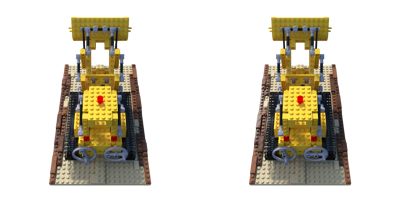
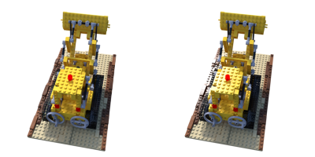
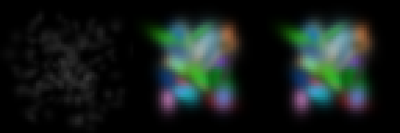
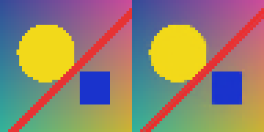

# 3D Gaussian Splatting from scratch

Rebuild a 3D scene from photos or a phone video and render it in the browser: my own differentiable Gaussian rasterizer (a pure-PyTorch reference, then a tile-based GPU version with a hand-written backward pass), the training loop with adaptive density control, evaluation on standard datasets, a WebGL viewer, and measured compression. Based on Kerbl, Kopanas, Leimkühler, Drettakis, *3D Gaussian Splatting for Real-Time Radiance Field Rendering*, SIGGRAPH 2023.

**Status:** Phases 1-2 done (maths, reference renderer, full training pipeline; lego trained on a Kaggle T4 with the reference renderer at 200×200). Phase 3 (Triton rasterizer with hand-written backward) is written and tested on the CPU, including the Triton kernels through Triton's interpreter; its GPU run has not happened yet, so there are no Phase-3 speed numbers. Phases 4-6 not started.

| Phase | What | Status |
|---|---|---|
| 1 | Maths + pure-PyTorch reference renderer (laptop CPU) | done |
| 2 | Training pipeline (density control, loaders, checkpoints) | done |
| 3 | Fast tile-based rasterizer with hand-written backward | code + CPU/interpreter tests done; GPU run pending |
| 4 | Real scenes + evaluation vs paper and gsplat | not started |
| 5 | WebGL viewer | not started |
| 6 | Compression (measured) + ship | not started |

## Setup (Windows laptop, CPU)

```powershell
winget install --id Python.Python.3.12 --exact --scope user
& "$env:LOCALAPPDATA\Programs\Python\Python312\python.exe" -m venv .venv
.venv\Scripts\python.exe -m pip install torch --index-url https://download.pytorch.org/whl/cpu
.venv\Scripts\python.exe -m pip install numpy pillow pytest
.venv\Scripts\python.exe -m pytest
```

Use the signed python.org build, not a `uv`-managed Python: with Windows Smart App Control on, the unsigned python-build-standalone interpreter that `uv` installs is blocked ("os error 4551").

Demos:

```powershell
.venv\Scripts\python.exe scripts\fit_2d.py          # fit an image with 2D Gaussians -> docs/images/phase1_fit2d.png
.venv\Scripts\python.exe scripts\fit_synthetic.py   # fit a synthetic 3D scene -> bench/results/phase1_synthetic_fit.md
```

GPU training and evaluation (Phases 2-4) run on Kaggle (2 x T4) or Colab through notebooks in `notebooks/` (generated by `scripts/make_notebooks.py`). The GPU-hour plan is in [bench/gpu_budget.md](bench/gpu_budget.md).

Training (any machine):

```powershell
.venv\Scripts\python.exe scripts\train.py --data <nerf_synthetic/lego> --format blender --downscale 4 --out runs\lego --name lego_ref_200
.venv\Scripts\python.exe scripts\train.py --data <360_v2/garden> --format colmap --images images_4 --out runs\garden --name garden
```

Running the same command again resumes from `runs/<name>/ckpt.pt`. `--render-mode` picks the renderer: `tiled` (PyTorch reference, autograd), `fast_torch` (hand-written backward in PyTorch) or `triton` (my Triton kernels, needs a CUDA GPU).

### Testing the Triton kernels locally (WSL)

Triton doesn't run on Windows, but its interpreter (`TRITON_INTERPRET=1`) runs the kernels on the CPU under Linux. In WSL Ubuntu:

```bash
curl -LsSf https://astral.sh/uv/install.sh | sh
~/.local/bin/uv venv --python 3.12 ~/gs-triton-venv
~/.local/bin/uv pip install --python ~/gs-triton-venv/bin/python torch --index-url https://download.pytorch.org/whl/cpu
~/.local/bin/uv pip install --python ~/gs-triton-venv/bin/python triton numpy pillow pytest
cd /mnt/c/Users/<you>/Documents/projects/gaussian-splatting
TRITON_INTERPRET=1 ~/gs-triton-venv/bin/python -m pytest tests/test_triton.py
```

On Windows, `tests/test_triton.py` is skipped (no Triton). On a CUDA machine it runs on the GPU.

## Layout

```
splat/
  maths.py        quaternion -> rotation, Sigma = R S S^T R^T, 2x2 inverse (conic)
  camera.py       pinhole camera (OpenCV convention), look_at, orbit cameras
  projection.py   world -> camera, perspective Jacobian, EWA 2D covariance, conic, radius
  sh.py           real spherical harmonics, degree 0-3
  gaussians.py    the parameter set (means, log-scales, quats, opacity logits, SH dc / rest)
  reference.py    dense pure-PyTorch rasterizer (autograd gives the gradients)
  losses.py       L1, SSIM, (1-l) L1 + l D-SSIM, PSNR
  fit2d.py        2D Gaussian image fitting (warm-up)
  simple_fit.py   Phase-1 3D fit with a fixed set of Gaussians
  colmap.py       my reader for COLMAP sparse models (binary + text), reprojection check
  data.py         NeRF-synthetic (Blender) and COLMAP scene loaders, train/test split, scene extent
  trainer.py      optimiser groups, LR schedule, density control, training step, checkpoints, eval
  fast/
    preprocess.py   per-Gaussian projection / conic / SH colour, with a hand-written backward
    binning.py      (Gaussian, tile) pairs sorted once by the 64-bit key tile << 32 | depth bits
    raster_torch.py tile rasterizer in PyTorch with the hand-written backward (readable spec, CPU float64)
    raster_triton.py the same algorithm as Triton kernels (forward front to back, backward back to front)
    __init__.py     render_fast(): preprocess -> binning -> rasterizer
scripts/          train.py, demos, notebook generator; every script writes bench/results/*.md
notebooks/        Kaggle/Colab notebooks (clone repo, test, train, package results)
bench/            gpu_budget.md, bench_rasterizer.py (mine vs reference vs gsplat), results/
tests/            unit tests (float64 where gradients are checked); test_triton.py runs on a GPU or the Triton interpreter
```

## How it works

### Phase 1: one Gaussian, from 3D to a pixel

**Parameters.** Each Gaussian has a mean μ ∈ ℝ³, a log-scale s ∈ ℝ³, a quaternion q = (w, x, y, z), an opacity logit, and SH colour coefficients. Everything is stored unconstrained so Adam can move it freely: scale = exp(s), opacity = sigmoid(logit), and q is normalised before use.

**3D covariance.** A covariance matrix must stay symmetric positive semi-definite while being optimised, so it is never optimised directly. It is built as

  Σ = R S Sᵀ Rᵀ,  R = rotation matrix of q/|q|,  S = diag(exp(s)).

Its eigenvectors are R's columns and its eigenvalues are the squared scales, so it is an oriented ellipsoid.

**To the camera.** With the world→camera rotation W and translation t, the centre in camera space is t_c = W μ + t, and the pixel position is u = f_x x/z + c_x, v = f_y y/z + c_y (OpenCV axes: x right, y down, z forward; pixel (i, j) has its centre at (i + ½, j + ½)).

**EWA projection.** Perspective projection is not linear, so a 3D Gaussian does not project to an exact 2D Gaussian. EWA splatting linearises the projection at the Gaussian's centre with its Jacobian

  J = ∂(u, v)/∂t_c = [[f_x/z, 0, −f_x x/z²], [0, f_y/z, −f_y y/z²]],

and a linear map of a Gaussian is a Gaussian, so the screen-space covariance is

  Σ' = J W Σ Wᵀ Jᵀ + 0.3 I.

The 0.3 I term (a ~0.55 px standard deviation blur) is the paper's low-pass filter: it keeps every splat at least about one pixel wide so tiny Gaussians do not alias or vanish between pixel centres. As in the reference CUDA code, x/z and y/z are clamped to 1.3 × the half-FoV tangent inside J only, so Gaussians far outside the view do not get exploding Jacobians. A Monte-Carlo test checks the approximation: 400k samples of a small 3D Gaussian, projected exactly, have a 2D covariance within 2 % of Σ' (without the low-pass).

**Conic and radius.** The inverse Σ'⁻¹ = [[a, b], [b, c]] (the "conic") is what the rasterizer needs: the Gaussian's falloff at offset d = (dx, dy) from its 2D centre is exp(−½(a dx² + 2b dx dy + c dy²)). For culling, the radius is 3 standard deviations along the largest axis, r = ⌈3 √λ_max⌉ with λ_max = m + √(m² − det), m = (Σ'₁₁ + Σ'₂₂)/2. Gaussians with z ≤ 0.2 (the near plane) or det ≤ 0 are dropped.

**Colour from spherical harmonics.** Colour depends on the view direction d = (μ − camera centre)/|…|. It is a weighted sum of real SH basis functions up to degree 3 (1, 4, 9 or 16 coefficients per colour channel): colour = Σ_k c_k Y_k(d) + 0.5, clamped at 0. Degree 0 is a constant (diffuse) colour; higher degrees add view-dependent effects such as highlights. The +0.5 offset makes a zero DC coefficient mean mid-grey. The basis constants are checked against the textbook formula built from associated Legendre polynomials and against orthonormality on the sphere.

**Alpha compositing.** Gaussians are sorted by camera-space depth of their centre (one global sort per image, not per pixel) and blended front to back at each pixel:

  α_i = min(0.99, o_i · exp(−½ dᵀ Σ'⁻¹ d)),  T_i = Π_{j<i} (1 − α_j),  C = Σ_i α_i T_i c_i + T_final · background.

T_i is the transmittance (how much light from behind still gets through). Three rules copied from the CUDA kernel matter for matching it later: α is clamped to 0.99 (so T never hits exactly 0, which keeps the backward pass invertible), contributions with α < 1/255 are skipped, and blending stops at the first Gaussian that would push T below 10⁻⁴ (that Gaussian is not blended). The reference renderer does this densely: every pixel against every visible Gaussian, with `cumprod` for the transmittances and a prefix mask for the early stop. A test checks it against a literal per-pixel loop written like the CUDA kernel.

**Gradients.** In Phase 1 PyTorch autograd differentiates through all of the above. `torch.autograd.gradcheck` in float64 checks the gradients of the rendered image with respect to every parameter (means, log-scales, quaternions, opacities, SH DC and higher orders) against finite differences. These are the gradients the hand-written backward pass of Phase 3 has to reproduce.

**Fitting.** Two demos show the gradients are useful, not just correct: 200 2D Gaussians fitting a procedural image, and a fixed set of 3D Gaussians fitting a synthetic 3D Gaussian scene from orbit views, scored on held-out views (Adam, 0.8 L1 + 0.2 D-SSIM). Both are also tests with convergence thresholds.

### Phase 2: training

**Tiled reference renderer.** The dense renderer of Phase 1 compares every pixel with every Gaussian, which cannot scale to 100k Gaussians. Training uses the "tiled" mode, which does exactly what the GPU rasterizers do:
1. Each visible Gaussian gets the rectangle of 16×16 tiles that its 3σ square [μ − r, μ + r]² overlaps.
2. One (tile, Gaussian) pair is created per covered tile. Gaussians are already in depth order, so a stable sort by tile id gives every tile its own front-to-back list. This is the same as sorting the 64-bit key (tile_id << 32 | depth) once.
3. Each tile composites only its list.

Tiles are batched (padded to the longest list in the batch) and each batch runs under `torch.utils.checkpoint`. The backward pass then recomputes a batch's intermediates instead of storing them for the whole image. Tile culling changes the maths slightly: a Gaussian can no longer reach a pixel outside its tiles, even where its α would be ≥ 1/255 (possible up to ~3.3σ when the opacity is close to 1). Tests check that tiled = dense whenever that cannot happen, and that tiled = dense with an explicit per-pixel tile mask otherwise. This tiled mode is the reference the Phase-3 kernel must match.

**Data.**
- *NeRF-synthetic:* `transforms_*.json` stores camera→world matrices in OpenGL axes (y up, z backward). Flipping the y and z columns gives OpenCV axes, and inverting gives world→camera. The RGBA images are composited on a white background.
- *COLMAP:* my reader handles both the binary and the text format. The poses are already world→camera in OpenCV axes. When images come from a downsampled folder (`images_4`), the intrinsics are scaled to the actual image size. A test projects the 3D points through the loaded poses and lands exactly on the stored 2D keypoints; on real data the same check (`colmap.reprojection_errors`) should give the usual ~1 px SfM error.
- *Split:* every 8th image (sorted by name) is held out for real scenes; NeRF-synthetic uses its own test split.
- *Scene extent:* 1.1 × the largest distance of a training camera from the cameras' mean. Learning rates and density thresholds are scaled by it.

**Initialisation.** Gaussians start at the SfM points, or at 100k random points in [−1.3, 1.3]³ for synthetic scenes. Each one starts isotropic with scale = RMS distance to its 3 nearest neighbours, identity rotation and opacity 0.1. The DC colour comes from the point colour and the higher SH coefficients start at 0.

**Optimiser.** Adam with one parameter group per attribute (ε = 10⁻¹⁵). The position LR decays log-linearly from 1.6·10⁻⁴·extent to 1.6·10⁻⁶·extent over the run: lr(t) = exp((1 − t) ln lr₀ + t ln lr₁). The other LRs are fixed: SH DC 2.5·10⁻³, higher SH 2.5·10⁻³/20, opacity 0.025, scale 5·10⁻³, rotation 10⁻³. The active SH degree rises by one every 1000 iterations, up to 3. The loss is 0.8·L1 + 0.2·(1 − SSIM).

**Adaptive density control** (every 100 iterations from 500 to 15k):
- *Accumulate:* every iteration, each visible Gaussian adds the norm of ∂L/∂(its 2D centre) to a running average. The paper's threshold of 2·10⁻⁴ is in NDC units, so the pixel-space gradient is multiplied by (W/2, H/2) first. A large average means the Gaussian is in a region that is not yet reconstructed well.
- *Clone:* above the threshold and small (max scale ≤ 1 % of the extent) → under-reconstruction. The Gaussian is copied, and the next gradient steps pull the two copies apart.
- *Split:* above the threshold and large → over-reconstruction (one big blob covering detail). It is replaced by 2 Gaussians whose centres are sampled from the parent's own distribution, with scale divided by 1.6.
- *Prune:* opacity < 0.005. After the first opacity reset, also anything wider than 20 px on screen or larger than 10 % of the extent in the world.
- *Opacity reset:* every 3000 iterations all opacities are clamped to ≤ 0.01. Gaussians that are really needed regain opacity, floaters stay transparent and get pruned.
- *Gaussian cap:* when set, only the candidates with the largest gradients are densified, so the count never goes above the cap.
- *Adam state:* new Gaussians get zero Adam moments, survivors keep theirs, and a reset tensor gets fresh moments. A test checks the moments stay aligned with their Gaussians through append/keep/replace.

**Checkpoints.** Every 1000 iterations, written atomically (to a temporary file, then renamed). A checkpoint holds the parameters, Adam state, density statistics, iteration, SH degree, the camera-order RNG and stack, and the torch RNG states. A test runs 40 iterations straight through and as 17 + save + load into a fresh trainer + 23, crossing densification and an opacity reset, and requires **bit-identical** parameters. A dropped Kaggle session therefore costs at most 1000 iterations. `--time-limit-hours` saves and exits cleanly before Kaggle's 12-hour limit.

### Phase 3: the fast rasterizer and its hand-written backward pass

The fast path computes the same image as the tiled reference, in three stages, each with a backward pass derived and written by hand (no autograd inside):

**1. Preprocess, one thread of work per Gaussian** (`splat/fast/preprocess.py`). Forward: covariance, projection, conic, radius and SH colour, exactly as in Phase 1. Backward: the chain rule, stage by stage in reverse:
- *Conic → 2D covariance.* With Σ' = [[A, B], [B, C]] and det = AC − B², the conic is (C, −B, A)/det. So, for example, ∂a/∂A = −C²/det², ∂a/∂B = 2BC/det², ∂a/∂C = 1/det − AC/det², and the same for b and c. Collecting ∂L/∂A, ∂L/∂B, ∂L/∂C gives a symmetric matrix G with L ≈ tr(G Σ') to first order.
- *2D covariance → 3D covariance and the Jacobian.* Σ' = T Σ Tᵀ with T = J W, so ∂L/∂Σ = Tᵀ G T and ∂L/∂T = 2 G T Σ, then ∂L/∂J = ∂L/∂T · Wᵀ.
- *Jacobian → camera-space point.* J has entries f/z and −f·t_x/z². Differentiating them gives terms like ∂J₀₂/∂z = 2 f t_x / z³. Where the 1.3×FoV clamp is active, t_x = ±lim·z, so the gradient goes into z instead of x. The 2D mean u = f x/z + c adds f/z and −f x/z². World positions get ∂L/∂μ = Wᵀ ∂L/∂t.
- *3D covariance → scale and rotation.* Σ = M Mᵀ with M = R S, so ∂L/∂M = 2 ∂L/∂Σ · M. That gives ∂L/∂s_j = Σᵢ ∂L/∂M_ij R_ij (times s for the log-scale) and ∂L/∂R = ∂L/∂M · S. Each of the 9 entries of R(q) is a quadratic in (w, x, y, z), differentiated entry by entry. Finally the quaternion normalisation: ∂L/∂q = (I − q̂ q̂ᵀ) ∂L/∂q̂ / |q|.
- *Colour.* ∂L/∂c_k = Y_k(d) ∂L/∂colour (zero where the colour was clamped at 0). The colour also depends on the view direction d = (μ − cam)/|μ − cam|, so μ gets Σ_k (c_k · ∂L/∂colour) ∇Y_k(d), projected by (I − d dᵀ)/|μ − cam|. The 15 gradient polynomials ∇Y_k are written out by hand (e.g. ∇(xyz) = (yz, xz, xy)).

**2. Binning with one sort** (`splat/fast/binning.py`). Each Gaussian is duplicated once per tile its 3σ square touches, with the 64-bit key `(tile_id << 32) | bits(float32 depth)`. Depths are positive, and the bit pattern of a positive IEEE-754 float increases with its value, so one sort of the keys orders the pairs by tile and, within each tile, front to back. A tile's list is the range between two offsets, found with a bincount + cumsum. Because the kernels order by float32 depth, the reference now does too, with ties broken by index (see bug 4 below).

**3. Rasterize, one program per 16×16 tile** (`splat/fast/raster_triton.py`).
- *Forward:* the tile's 256 pixels are the lanes of one Triton block. They walk the tile's list front to back, each keeping its colour, its transmittance T and how far down the list it got (`last`). The loop stops when every pixel in the tile is done. Only the final T and `last` are stored per pixel, not the per-Gaussian alphas.
- *Backward:* walk the same list **back to front**. With g = ∂L/∂C for the pixel, and C = Σ αᵢTᵢcᵢ + T_f·bg:

  ∂L/∂cᵢ = αᵢ Tᵢ g,   ∂L/∂αᵢ = Tᵢ (cᵢ·g) − Sᵢ / (1 − αᵢ),   Sᵢ = Σ_{j>i} αⱼTⱼ(cⱼ·g) + T_f (bg·g − ∂L/∂acc).

  Sᵢ is "everything behind Gaussian i". Going back to front, it is a running sum that starts at T_f(bg·g − ∂L/∂acc) and grows by αᵢTᵢ(cᵢ·g) after each Gaussian. Tᵢ itself is not stored: each pixel starts from its final T and recovers the transmittance in front of each Gaussian as Tᵢ = Tᵢ₊₁ / (1 − αᵢ). This is why α is clamped to 0.99: the division never blows up. From ∂L/∂α the rest is local: with α = min(0.99, oG) and G = exp(p), ∂L/∂o = G ∂L/∂α and ∂L/∂p = oG ∂L/∂α (both 0 where the clamp is active). Then ∂L/∂μ₂D = ∂L/∂p (a dx + b dy, b dx + c dy) and ∂L/∂(a, b, c) = ∂L/∂p (−dx²/2, −dx dy, −dy²/2).
- *Summing per Gaussian:* the 256 pixels' contributions to one Gaussian are summed with `tl.sum` inside the block. Then one `atomic_add` per value per tile writes them to global memory, instead of 256 atomics per Gaussian.

`splat/fast/raster_torch.py` computes the same gradients in vectorised PyTorch (S as a reversed cumulative sum). It is the readable spec of the kernels and runs on the CPU in float64.

**How it is tested.**
- Every gradient of the hand-written backward (all six parameter groups, through all three stages) is compared with autograd through the tiled reference in float64: within 10⁻¹⁰ for the PyTorch spec, and 10⁻⁸ for the Triton kernels.
- The test scenes cover Gaussians behind the camera, off-screen and FoV-clamped Gaussians, huge Gaussians, mostly empty tiles, opaque stacks that stop early, image sizes that aren't multiples of 16, the alpha output and a non-black background.
- float32 kernels vs the float64 reference, with stated tolerances.
- 30 training iterations, including densification and an opacity reset, must give the same parameters with the hand-written backward (PyTorch spec and Triton) as with autograd.
- On the laptop the Triton kernels run in Triton's CPU interpreter (WSL). On Kaggle the same tests run compiled on the T4.

## Results

### Phase 3: Triton rasterizer (GPU)

_Not run yet._ `notebooks/phase3_triton.ipynb` writes `lego_triton_800.md` (lego at full 800×800, the Phase-3 "done" run), `lego_triton_200.md` (exactly the Phase-2 settings on the Triton rasterizer, for a like-for-like speed and quality comparison with the reference run below), and two benchmark tables (random scenes at 200/400/800 px × 10k–300k Gaussians, and the trained lego scene), with gsplat on the same T4 as a reference. Numbers go here once it has run.

### Phase 2: lego with the reference renderer (GPU)

From [bench/results/lego_ref_200.md](bench/results/lego_ref_200.md), written by `notebooks/phase2_lego.ipynb` → `scripts/train.py`. Setup: one Kaggle Tesla T4 (PyTorch 2.11, CUDA 13.0), commit 93b96fd, NeRF-synthetic lego downscaled 4× to 200×200, white background, 100 train / 200 test views (the dataset's own test split), 100k random init points, 30k iterations, paper hyperparameters, seed 0, 1 run. The training log is in [bench/results/lego_ref_200_log.csv](bench/results/lego_ref_200_log.csv).

| metric (200 test views, 200×200) | value |
|---|---:|
| PSNR (dB) | **35.42** (per-view min 25.25, max 41.06, std 3.20) |
| SSIM | 0.9898 |
| LPIPS (VGG, `lpips` package) | 0.0107 |
| final Gaussians | 109,695 |
| training time (sum of iteration times) | 3.86 h (0.463 s/iteration) |
| peak GPU memory allocated | 0.46 GB |
| render time per view (reference renderer) | 0.134 s |

These numbers show the pipeline works end to end. They are **not comparable** to the paper's lego numbers: the images are 4× smaller (fewer high-frequency details, so higher PSNR is easier), the renderer is the unoptimised reference, and this is one run. The paper comparison, at 800×800 with the fast rasterizer and against gsplat on the same T4, is Phase 4.

What the log shows:
- **Most of the random init is pruned at once.** For white-background scenes the paper's code also resets opacity at iteration 500 (the densification start). At the first densification after that (iteration 600), 83,994 of the 100k random points still have opacity below 0.005 and are pruned, leaving 16,476. From there clone and split grow the count past 100k again by iteration 4,500.
- **The Gaussian cap never mattered.** The peak was 114,793 Gaussians (iteration 9,000), well under the 200k cap. When densification stopped at 15k, 109,695 were left.
- **Iterations got cheaper as the scene sharpened,** from 0.65 s at 100k large random Gaussians to about 0.47 s at 110k smaller ones, because smaller Gaussians touch fewer tiles.

Renders on held-out test views (left: mine, right: ground truth):




### Phase 1: synthetic scene fit (CPU, reference renderer)

From `bench/results/phase1_synthetic_fit.md` (`scripts/fit_synthetic.py`):

Setup: 40 random ground-truth Gaussians (SH degree 1), 24 orbit views at 48×48 px with every 8th view held out (3 test views), a model of 200 randomly initialised Gaussians without densification, 2,000 Adam iterations, i5-1135G7 CPU, PyTorch 2.15 CPU, commit 7a071a7.

| seed | test PSNR at init (dB) | test PSNR final (dB) | test SSIM final | wall time (s) |
|---:|---:|---:|---:|---:|
| 0 | 13.79 | 42.67 | 0.9971 | 138 |
| 1 | 12.96 | 44.42 | 0.9976 | 112 |
| 2 | 13.10 | 42.18 | 0.9965 | 119 |

Mean held-out PSNR **43.09 dB** (range 42.18-44.42) and mean SSIM 0.9971 over 3 runs. This is a synthetic check that the optimisation works. It is not comparable to the paper's numbers on real data.

Init | fitted | ground truth on a held-out view (48×48, upscaled 4×):



2D warm-up, target | fit (`scripts/fit_2d.py`):



## Bugs found on the way

1. **A float64 test leaked into the float32 tests.** *Symptom:* `test_fit.py` passed on its own but failed in the full suite with `expected m1 and m2 to have the same dtype`. *Cause:* the float64 test modules called `torch.set_default_dtype(torch.float64)` at import time. pytest imports every module before running any test, so the global default was float64 everywhere, the Gaussians were created in float64 and the cameras in float32. *Fix:* a `float64` fixture in `tests/conftest.py` that sets and restores the default per test, and `render()` now casts the camera to the Gaussians' dtype. *Guard:* the full suite runs the float32 fit tests next to the float64 ones.
2. **A test sat exactly on the early-stop threshold.** *Symptom:* the early-termination test expected 4 layers with α = 0.9 to be blended, but the renderer blended 3. *Cause:* after 4 layers T = 0.1⁴, which is 10⁻⁴ only in exact arithmetic; in float64 1 − 0.9 = 0.09999999999999998 and the product is 9.999999999999991 × 10⁻⁵, just below 10⁻⁴, so the "stop if T < 10⁻⁴" rule fires one layer early. The renderer was right; the test was ambiguous. *Fix:* the test uses α = 0.85 (T after 4 layers = 5.1 × 10⁻⁴, after 5 = 7.6 × 10⁻⁵), far from the threshold. *Lesson for Phase 3:* float32 GPU kernels and the reference can disagree about pixels whose T is within rounding of 10⁻⁴; the comparison tests must expect that.
3. **A test that could not fail (Phase 2).** *Symptom:* the test meant to show that tile culling changes high-opacity renders ("tiled ≠ dense") failed: they were identical. *Cause:* the test image was 40×27 px, only 3×2 tiles, and every Gaussian's 3σ square touched every tile, so culling never removed anything. The companion test "tiled = dense with the tile mask" was therefore passing without testing anything. *Fix:* the test uses a 128×96 image (8×6 tiles), and asserts that the difference is non-zero and bounded (< 0.02, from α ≤ 0.99·e^−4.5 outside the 3σ square). *Guard:* the non-vacuity assertion itself.
4. **Float64 training diverged between the two backward passes (Phase 3).** *Symptom:* a 30-iteration float64 training run with the hand-written backward and the same run with autograd made identical densification decisions, but at iteration 21 one Gaussian's colour gradient differed by 1 % (far more than float64 rounding), and the runs drifted apart after that. *Cause:* two Gaussians had different float64 depths (2.78196807 vs 2.78196823) that round to the same float32. The fast path sorts by the float32 bit pattern (like the CUDA rasterizer) and breaks the tie by index; the reference sorted by the float64 depth. So the pair composited in opposite orders in the two paths. *Fix:* depth order is now defined once, as float32 depth with ties broken by index, and the reference uses that definition too. Float32 training was never affected (both paths already saw float32 depths), so the Phase 1 and 2 results stand. *Guard:* the float64 "trains identically" tests for both the PyTorch spec and the Triton kernels.
5. **The trainer loaded target images as float32 regardless of the model's dtype (Phase 3).** *Symptom:* the first float64 training test crashed in SSIM's convolution with a dtype mismatch. *Cause:* `Frame.image_float()` defaulted to float32, which was fine until something trained in float64. *Fix:* the trainer asks for the Gaussians' dtype. *Guard:* the float64 training tests.
6. **`train.py --render-mode triton` would have crashed after training (Phase 3, found by a smoke run in WSL).** *Symptom:* none yet on a GPU. A CPU smoke run of the script showed it. *Cause:* `train.py` imported the reference `render()` for the final test renders, and that function doesn't know the `triton` mode, so a GPU run would have failed after hours of training, at the evaluation step. The same block also timed PNG writing as if it were rendering. *Fix:* `train.py` uses the trainer's renderer dispatch, and the render time is now measured over all test views with nothing else in the loop. *Guard:* the smoke run (train 6 iterations, resume to 12, evaluate) is now part of checking a script change before a GPU run.
7. **Design mistake caught before running (no test found it):** I first gave the higher-order SH coefficients a smaller learning rate by scaling their gradients with a hook. Adam divides by the running RMS of the gradient, so a constant gradient scale cancels out and changes nothing. *Fix:* the SH DC and higher-order coefficients are separate tensors (`sh_dc`, `sh_rest`) in separate Adam parameter groups, as in the original implementation.

## Honest limits

- The reference renderer is dense (every pixel × every Gaussian), so it only runs at tiny resolutions and Gaussian counts. It is the correctness baseline, not the fast path.
- The Triton kernels have only been run in Triton's CPU interpreter so far. Compiled GPU behaviour (and speed) comes from the Phase-3 notebook. The preprocess and binning stages are vectorised PyTorch (with a hand-written backward), not custom kernels.
- My backward pass is the exact derivative of my forward pass, including a zero gradient where α is clamped at 0.99.
- Phase 2 trains with the PyTorch reference renderer, which is far too slow for full resolution. The Phase-2 lego run is at 200×200 with a cap of 200k Gaussians, and is a pipeline check, not a paper comparison. Paper-comparable runs need the Phase-3 rasterizer.
- Not implemented from the official code: random background colours during training, exposure compensation, anti-aliasing, and the later densification variants. Images are resized with PIL bicubic.
- The CPU tests use synthetic data. The CUDA consistency test passed on the T4. The only real-data run so far is lego (synthetic renders, no COLMAP); the COLMAP loader has only been run on test fixtures, and its first real run is Mip-NeRF 360 in Phase 4.
- The Phase-2 lego result is one seed. Run-to-run spread is measured in Phase 4.
- The Phase-1 scene is synthetic (random ground-truth Gaussians rendered by the same renderer), so it shows the optimisation works, not that it reconstructs real photos.
- The EWA projection is a first-order approximation (exact only for small Gaussians); this is the paper's method, not a bug. Anti-aliasing beyond the 0.3 low-pass (Mip-Splatting) is a stretch goal.
- Camera poses and initial points for real scenes will come from COLMAP, which is not my code. Structure-from-motion is a separate project.

## References

Kerbl et al., 3D Gaussian Splatting (SIGGRAPH 2023) and its supplementary; Zwicker et al., EWA Splatting (2002); the original `diff-gaussian-rasterization` CUDA code and gsplat's maths notes (read for reference, no code vendored).
